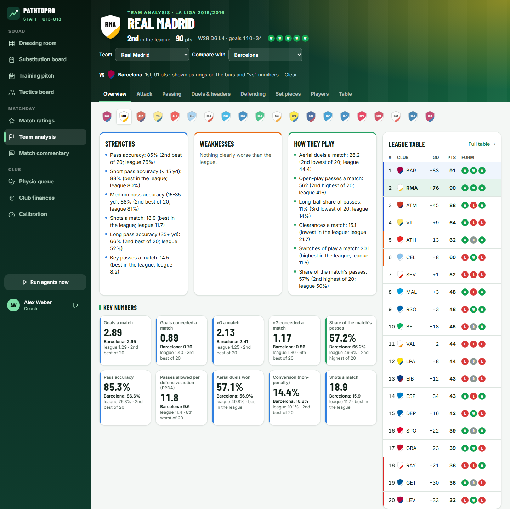

# PathToPro

Agent system that watches each young footballer's load, growth, recovery and
development, then rebuilds next week's plan before problems happen. Academy coaches
approve risky changes. Players outside an academy get a self guided pathway with five
levels, benchmark tests and the same safety engine. 

**Design principle:** code computes, the LLM plans and explains, a fixed policy decides who approves.
Without an API key the LLM's part is done by rules, which is how every result below was produced.



## Try it

**Live demo: https://bachcodingg.github.io/path_to_pro/** (no install, no account)

The website runs entirely in your browser on a snapshot of the synthetic season, recorded
from the real API. Pick a demo account on the sign-in page; changes stay in your browser
until you press "Reset demo". On a phone, use "Add to Home Screen" to install the player
app (PWA). Sign-up and plain-words coach instructions need the full system (below).

| Demo account | Shows |
| --- | --- |
| Leon, U15 (tired, growth zone) | Check-in, Today, why-cards, growth zone, position gym session |
| Dual-squad player (U19 + men's team) | Dual registration: 90 minutes shared over a Saturday + Sunday double; Career tab with ratings; match diary |
| Self-guided player | Levels: log a wall-pass test of 18+ and she moves up to level 3 |
| Coach | Heatmap, approval inbox, training pitch, match ratings, tactics board, team analysis (how an opponent passes, shoots, defends and takes set pieces, player by player; full league table with form and home / away), profile with gym preview and instruction box, calibration |
| Men's team coach | Second team's view of the dual-registered players (sees, but the primary coach approves) |
| Physio, Guardian | Escalation queue; consent per data type |

## Deploy the full system (Render, free)

1. Sign in at https://render.com with your GitHub account.
2. **New → Blueprint**, pick this repository. Render reads `render.yaml`: one web service
   (API + website from the root `Dockerfile`) and a PostgreSQL database, both in Frankfurt.
3. Leave `ANTHROPIC_API_KEY` empty (rule-based agents) or paste a key to turn on Claude.
4. **Apply**. The first build takes ~5 minutes; on first start the server loads the
   synthetic demo season (about a minute; `/api/health` shows `"data": "seeding"`).

Secrets are generated by Render and production mode is on (the seed endpoint is off).
This is a **demo deployment**: the demo accounts share a published password, so self sign-up
is off and there is no admin account. For real players, run a separate deployment with
`PATHTOPRO_AUTOSEED=off` and `PATHTOPRO_REGISTRATION=on`; the server refuses to start with both
on in production. An admin account exists only if you set `PATHTOPRO_ADMIN_PASSWORD` before seeding. An existing database gets
the new columns automatically on start. Free tier limits: the service sleeps after 15
minutes idle (~1 min to wake), and a free database expires after 30 days. CI builds this
same image and runs the end-to-end tests against it on PostgreSQL on every push.

## Run it

```bash
docker compose up --build          # PostgreSQL + API + web, seeds the synthetic demo season
open http://localhost:8080         # demo accounts on the login page, password demo1234
```

Without Docker:

```bash
cd backend && python -m venv .venv && .venv/Scripts/activate   # .venv/bin/activate on macOS/Linux
pip install -e ".[dev]"
uvicorn api.main:app --port 8000                                # then: curl -X POST localhost:8000/api/demo/seed
cd ../frontend && npm ci && npm run dev                         # http://localhost:5173
```

Optional: set `ANTHROPIC_API_KEY` to let Claude propose constraints, explanations, drill
picks and parse coach instructions (answers are cached in `backend/llm_cache/`). Without a
key, or with `PATHTOPRO_LLM=off`, the agents use rule-based fallbacks and the demo works offline.
No cached answers are committed, so the offline demo and every result below are the
rule-based agents: the LLM's contribution has not been evaluated yet.

## What's in it

| Area | Implementation |
| --- | --- |
| Agents and autonomy | `backend/agents/`: Monitor, Planner, Development Coach, Coordinator policy table, coach-instruction parser |
| Sports science engine | `backend/analytics/`: sRPE, EWMA ACWR, monotony, strain, Mirwald, readiness, bio-banded norms |
| Weekly planner | `backend/planner/`: OR-Tools CP-SAT, hard rules H1-H9, projected ACWR, club training nights, relaxation, safe template |
| Gym programmes | `backend/gym/` + `config/gym.yaml`: shared injury-prevention work for every player plus a block per position (GK, CB, FB, CM, W, ST), adjusted for growth stage, readiness, match proximity and equipment |
| Self-guided pathway | `backend/pathway/` + `config/pathway.yaml`: 5 levels, 6 benchmark tests (age- and sex-adjusted), level-ups, solo session content, sign-up with parent invite codes under 16 |
| Teams, careers, ratings | `backend/performance/` + `config/competitions.yaml`: dual registration with rule H8, league ladder (Finland first), career CV, match diary, 3-10 match ratings with a breakdown, coach training pitch |
| Club finances | `backend/finance/`: contracts (academy fees, semi-pro/pro salaries, staff), running costs and income, automatic match bonuses and title bonuses, ledger; coach page, player and parent views. See [docs/finances.md](docs/finances.md) |
| Apple Watch | `backend/devices/`: iPhone Shortcut ingest with write-only device codes, Apple Health export upload (safe streaming XML parser), HRV (SDNN) + sleep + workouts into readiness and load. See [docs/apple-watch.md](docs/apple-watch.md) |
| User interface | Laid out like the LaLiga and Premier League sites: every page opens with a header band (title in a condensed display face, the page's key number, its tabs), club badges and W/D/L form next to team names, a split-screen sign-in with the demo accounts grouped by role; skip link and a tab title per page. `frontend/`: player PWA (check-in, Today, week pitch, gym, growth, card, season map, levels) for phone and laptop: bottom tabs on a phone, a sidebar and two-column pages from tablet width; coach (heatmap, inbox with A/E/R, tactics board, team analysis, scouting report with instruction box, match commentary, calibration), physio queue, guardian view, sign-up |
| Architecture | FastAPI, SQLAlchemy 2, Alembic, PostgreSQL, APScheduler, JWT + RBAC, `docker-compose.yml` |
| Simulator | `backend/simulator/`: 25 players x 40 weeks, seeded, 3 injury models, pluggable policy |
| Evaluation | `backend/eval/`: `python -m eval`, 54-case safety suite, equal-load and heuristic-coach baselines, 10-seed CIs (`python -m eval.seeds`), report in [docs/evaluation/report.md](docs/evaluation/report.md) |
| Team analysis | `backend/scouting/`: real La Liga 2015/16 event data (StatsBomb Open Data, all 380 matches). Per team, against the rest of the league with a rank: pass accuracy by length (short, medium, long), long-ball share, crosses, through balls, key passes; shots by zone (tap-in range, box, long shots), headers, big chances, counters, conversion, xG; aerial duels, dribbles, tackles; pressing (PPDA, high pressures, counter-pressing), shots and xG conceded; discipline. Set pieces: corner delivery zones, swing, takers, corners defended, penalty and free-kick placement. Shot map, squad leaders and table, league table (form, home / away, European and relegation places), a club badge strip to switch team, side-by-side comparison. A strength, weakness or habit is named only when its 95% interval excludes the league. See [docs/team-analysis.md](docs/team-analysis.md) |
| Safety and ethics | [docs/safety-case.md](docs/safety-case.md): encryption, audit log, consent, export/delete, escalations |

More: [teams, careers and ratings](docs/teams-careers-ratings.md) · [team analysis](docs/team-analysis.md) · [gym and pathway](docs/gym-and-pathway.md) · [architecture](docs/architecture.md) · [demo script](docs/demo-script.md) · [week-1 decisions](docs/week1-scope.md)

## Results (25 players x 40 weeks, 3 injury models, 10 seeds)

Three policies face the same simulated seasons: the plan's **baseline** (a fixed template
with random RPE, blind to exams and fixtures), a **heuristic** coach (the same template
plus the safety rules as plain if-statements) and the **agents** (rule-based, no LLM).
Mean [95% CI] over 10 seeds unless noted; details in
[seeds.md](docs/evaluation/seeds.md) and [report.md](docs/evaluation/report.md) (seed 2026).

| Metric | Target | Result |
| --- | --- | --- |
| Hard rule violations in executed weeks | 0 | **0** on every seed (baseline ~380, heuristic 0) |
| Safety scenario suite | all pass | **54/54** |
| Player-weeks with ACWR > 1.5 vs baseline | ≥ 50% fewer | **68-70% fewer** (CIs 51-87%) |
| Same, vs the heuristic coach | fewer | **67-71% fewer** (CIs 57-85%): what the planner adds beyond the rules |
| Injuries vs the heuristic coach (secondary, synthetic model) | fewer | **no detectable difference** (every CI contains 0; under the readiness model the agents lean worse, +2.2 [-0.1, 4.5]) |
| Injuries vs the baseline (same caveat) | fewer | fewer only under the readiness model (-4.0 [-6.0, -2.0]); load and random models: CIs contain 0 |
| Player-weeks with monotony > 2 | ≥ 40% fewer | **worse, target unreachable**: the baseline never exceeds 2; the agents have ~1 of the squad's 1,000 player-weeks above 2 per season (CI -0.5 to 2.6; seed 2026: 3-4) |
| Development sessions delivered | ≥ 90% | **91-92%** (seed 2026) |
| Solver time | < 2 s / player-week | **≤ 0.79 s** (seed 2026; wall-clock, varies with the machine) |
| Readiness colour changes day to day | fewer, no delayed warnings | 58% -> 44% of days (safety-first buffer, seed 2026) |
| Readiness weight sensitivity | < 10% bands change | 15.0% -> 13.0%: **still fails**; 91% of flipped days were within 5 points of a colour boundary (seed 2026) |

**What these results don't show.** Fewer ACWR spikes is partly the planner meeting its own
objective (it penalises projected ACWR), and the 54 scenarios were written by the same team
as the code. The injury model is synthetic, so injuries are a secondary result. Weight
calibration has only been run on the simulator's synthetic staff ratings.

**Not measured yet:**
- **LLM contribution.** Every result above is the rule-based agents; there is no
  with-vs-without-LLM comparison and no first-try validity rate (needs an API key).
- **People.** No coach or player interviews, no SUS score, no expert rating of plans.
- **Notification time.** A red check-in is queued for staff in milliseconds, but there is
  no push, email or SMS channel, so the time until a person sees it is unknown.
- **Norms.** Benchmark norms are placeholders, so bio-banded percentiles are illustrative.

**Readiness calibration:** staff rate players in the heatmap ("How ready does he look?");
the Calibration page suggests weights that agree best with staff without missing more red
days. A coach can apply them only when the improvement on held-out players is clearly
above the fold-to-fold noise. Demo ratings are synthetic.

## Tests

```bash
cd backend && pytest                      # 210 unit, scenario and API tests
cd backend && python -m eval              # evaluation report (seed 2026) -> eval_results/
cd backend && python -m eval.seeds        # 10-seed comparison with confidence intervals
cd frontend && npm test                   # Vitest (8 component tests)
cd frontend && npx playwright test        # 23 end-to-end tests (API on :8000, web on :5173)
```

All academy demo data is synthetic. No real player data is stored. Benchmarks and norms are
placeholder values until validated against club data. The one exception is Team analysis,
which uses published professional match events: data from StatsBomb Open Data
(https://github.com/statsbomb/open-data), credited as their terms require.
