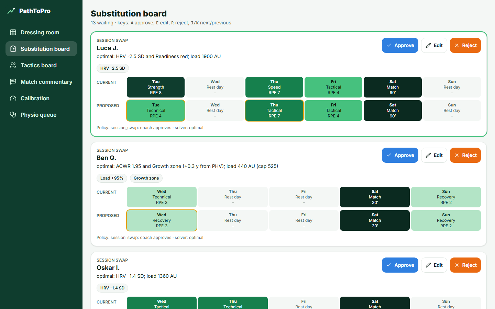

# PathToPro

Agent system that watches each academy player's load, growth, recovery and
development, then rebuilds next week's plan before problems happen. Coaches
approve risky changes.

**Design principle:** code computes, the LLM plans and explains, a fixed policy decides who approves.



## Run it

```bash
docker compose up --build          # PostgreSQL + API + web, seeds the synthetic demo season
open http://localhost:8080         # demo accounts on the login page, password demo1234
```

Without Docker:

```bash
cd backend && python -m venv .venv && .venv/Scripts/activate   # .venv/bin/activate on macOS/Linux
pip install -e ".[dev]"
uvicorn api.main:app --port 8000                                # then: curl -X POST localhost:8000/api/demo/seed
cd ../frontend && npm ci && npm run dev                         # http://localhost:5173
```

Optional: set `ANTHROPIC_API_KEY` to let Claude propose constraints, explanations and
drill picks (answers are cached in `backend/llm_cache/`). Without a key, or with
`PATHTOPRO_LLM=off`, the agents use rule-based fallbacks and the demo works offline.

## What's in it

| Plan section | Implementation |
| --- | --- |
| 2. Agents and autonomy | `backend/agents/`: Monitor, Planner, Development Coach, Coordinator policy table |
| 3. Sports science engine | `backend/analytics/`: sRPE, EWMA ACWR, monotony, strain, Mirwald, readiness, bio-banded norms |
| 4. Weekly planner | `backend/planner/`: OR-Tools CP-SAT, hard rules H1-H7, projected ACWR, relaxation, safe template |
| 5. User interface | `frontend/`: player PWA (check-in, Today, week pitch, growth, card, season map), coach (heatmap, inbox with A/E/R, tactics board, scouting report, match commentary), physio queue, guardian view |
| 6. Architecture | FastAPI, SQLAlchemy 2, Alembic, PostgreSQL, APScheduler, JWT + RBAC, `docker-compose.yml` |
| 7. Simulator | `backend/simulator/`: 25 players x 40 weeks, seeded, 3 injury models, pluggable policy |
| 9. Evaluation | `backend/eval/`: `python -m eval`, 50-case safety suite, report in [docs/evaluation/report.md](docs/evaluation/report.md) |
| 10. Safety and ethics | [docs/safety-case.md](docs/safety-case.md): encryption, audit log, consent, export/delete, escalations |

More: [architecture](docs/architecture.md) · [demo script](docs/demo-script.md) · [week-1 decisions](docs/week1-scope.md)

## Results (25 players x 40 weeks, 3 injury models, vs a fixed weekly template)

| Metric | Target | Result |
| --- | --- | --- |
| Hard constraint violations | 0 | **0** (baseline: ~375 per season) |
| Safety scenario suite | 50/50 | **50/50** |
| Player-weeks with ACWR > 1.5 | ≥ 50% fewer | **58-66% fewer** |
| Development sessions delivered | ≥ 90% | **91-92%** |
| Solver time | < 2 s / player-week | **≤ 0.21 s** |
| Readiness colour changes day to day | fewer, no delayed warnings | 58% -> 44% of days (safety-first buffer) |
| Weights calibrated against staff ratings | better agreement, red recall kept | kappa 0.32 -> 0.34 (synthetic ratings) |
| Readiness weight sensitivity | < 10% bands change | 15.0% -> 13.0% with buffer + calibration (see [safety case](docs/safety-case.md)) |

Not yet measured: LLM first-try validity (needs an API key), expert plan ratings and SUS
(need people). Weeks with monotony > 2 can't show a reduction: the baseline never exceeds 2.

**Readiness calibration:** staff rate players in the heatmap ("How ready does he look?");
the Calibration page suggests weights that agree best with staff without missing more red
days, and a coach applies them. Demo ratings are synthetic.

## Tests

```bash
cd backend && pytest                      # 125 unit, scenario and API tests
cd frontend && npm test                   # Vitest
cd frontend && npx playwright test        # end-to-end demo flow (API on :8000, web on :5173)
```

All demo data is synthetic. No real player data is stored.
